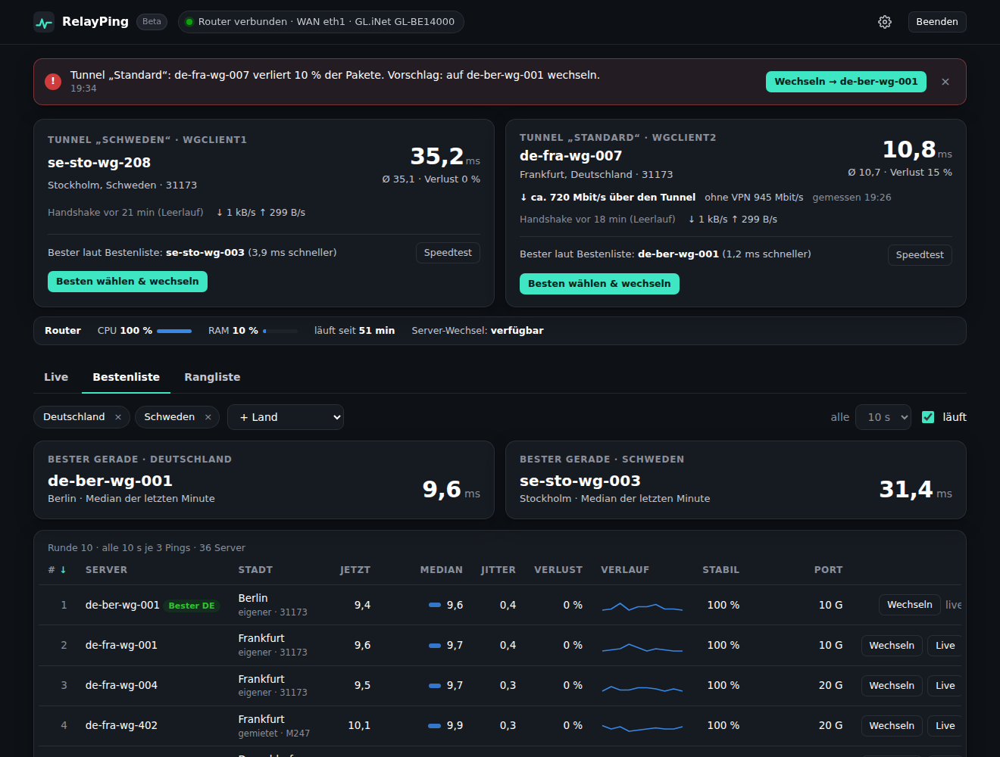
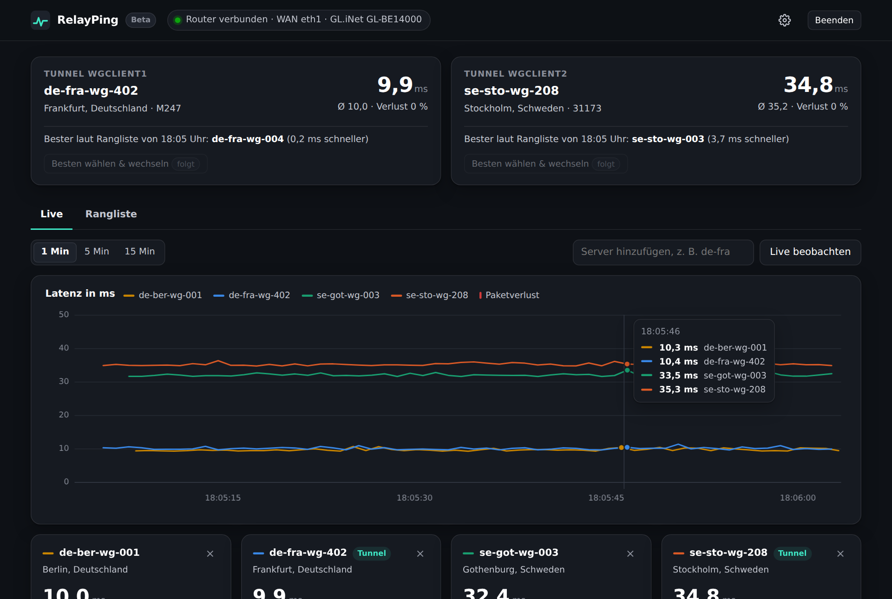
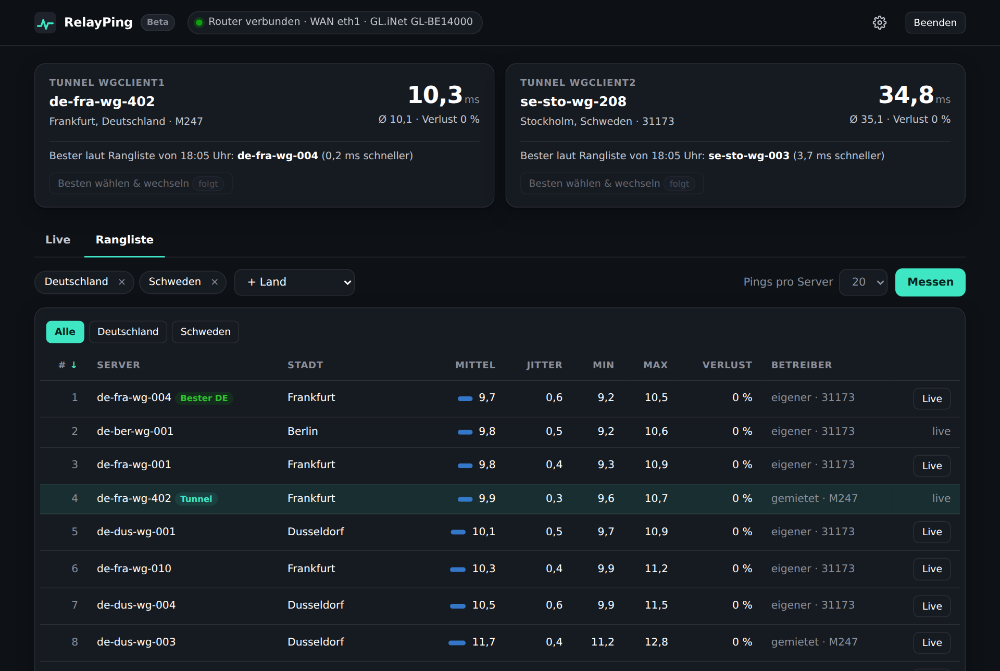

# RelayPing

**Live-Latenz zu Mullvad-WireGuard-Servern – gemessen von deinem Router aus (GL.iNet, OpenWrt, Asus), auf Wunsch mit FRITZ!Box.**

RelayPing ist ein kleines, portables Windows-Tool: eine einzige `.exe`, keine Installation. Es zeigt dir in Echtzeit, wie schnell die Mullvad-Server von deinem Anschluss aus erreichbar sind, hält eine laufend aktualisierte Bestenliste ganzer Länder und stellt einen Tunnel **auf Knopfdruck** auf einen besseren Server um.

> **Vorabversion (Beta).** Messungen und Server-Wechsel laufen auf einem echten Flint 4 (GL-BE14000, Firmware 4.9.2). Tagesbericht, Länder-Tab und Leitungs-Tab, OpenWrt, Asus und FRITZ!Box sind bisher nur gegen nachgebaute Geräte getestet. Rückmeldungen über die Issues sind willkommen.
>
> **Inoffizielles Community-Tool.** RelayPing steht in keiner Verbindung zu Mullvad VPN AB, GL.iNet, ASUS oder AVM. „Mullvad“, „GL.iNet“, „ASUS“ und „FRITZ!Box“ sind Marken ihrer jeweiligen Inhaber.

**Grundsatz:** RelayPing liest nur. Einstellungen am Router oder an der FRITZ!Box ändert es nicht – einzige Ausnahme ist der Server-Wechsel, den du selbst per Knopf auslöst. Beim ersten Anmelden legt es seinen SSH-Schlüssel auf dem Router ab, sonst nichts.



## Warum am Router messen?

Wenn dein VPN auf dem Router läuft, geht jeder Ping vom PC erst durch den aktiven Tunnel. Du würdest also messen, wie schnell *der VPN-Server* die anderen Server erreicht, nicht dein Anschluss. RelayPing lässt deshalb den Router selbst pingen, über die WAN-Leitung am Tunnel vorbei. Der PC zeigt nur an.

## Funktionen

- **Unterstützte Router:**
  | Router | Messen | Server-Wechsel | Besonderheiten |
  |---|---|---|---|
  | GL.iNet (Firmware 4.x) | ja | über die GL.iNet-Schnittstelle, wie das Admin-Panel | Tunnel-Namen, Domainlisten, Geräteliste mit Datenmengen |
  | OpenWrt mit WireGuard | ja | Gegenstelle per `uci`, dann `ifup` | nur Tunnel mit genau einer Gegenstelle |
  | Asus (Asuswrt-Merlin, neuere Original-Firmware mit WireGuard-Client) | ja | `nvram wgcN_*` und `service restart_wgc N`, wie die Asus-Oberfläche | SSH in der Asus-Oberfläche einschalten; Schlüssel einmal selbst unter „Autorisierte Schlüssel“ eintragen, sonst nach jedem Router-Neustart neu anmelden |
- **FRITZ!Box (zusätzlich, nur lesen):** Internetverbindung, aktuelle Datenrate, Leitungsgeschwindigkeit, Verbrauch heute und im Monat, Neuverbindungen und – mit Benutzer und Passwort – Neustarts der Box. Über die offiziellen Schnittstellen von AVM (UPnP-Statusinformationen, TR-064). Praktisch, wenn die FRITZ!Box vor dem VPN-Router hängt: Ihre Zähler sind ein Gegencheck, falls die Hardware-Beschleunigung des Routers Verkehr an seinen Zählern vorbeischleust. Das Passwort ist optional und wird mit Windows (DPAPI) verschlüsselt gespeichert. Pings vom Router aus gibt es bei der FRITZ!Box nicht, weil sie keinen Shell-Zugang hat.
- **Tunnel-Übersicht:** erkennt die aktiven WireGuard-Tunnel des Routers (bei GL.iNet und Asus mit ihren Namen) und zeigt Live-Latenz, Handshake-Alter und Datenrate.
- **Bestenliste:** pingt alle Server der gewählten Länder dauerhaft (Standard: alle 10 s je 3 Pings) und sortiert laufend nach Verlust und Median der letzten Minute. Mit Verlaufskurve, Stabilitätswert, Portgeschwindigkeit und dem aktuell besten Server je Land.
- **Server wechseln per Knopf:** „Besten wählen & wechseln“ am Tunnel oder „Wechseln“ in jeder Zeile. RelayPing stellt den Tunnel um (siehe Tabelle), wartet auf den WireGuard-Handshake und stellt nach 35 Sekunden ohne Verbindung automatisch den vorherigen Server wieder ein. Gewechselt wird nur innerhalb desselben Landes und nur auf Knopfdruck, nie automatisch.
- **Warnungen:** verliert der Server eines Tunnels Pakete oder ist er deutlich langsamer als der beste im Land, erscheint ein Hinweis mit Wechsel-Vorschlag, auch als Windows-Benachrichtigung. Schwellen einstellbar.
- **Speedtest:** lädt vom Router aus ca. 10 Sekunden lang durch den Tunnel herunter (Cloudflare-Testdatei, 4 Verbindungen) und zum Vergleich ohne VPN. Ergebnis ist ein Richtwert, die Router-CPU begrenzt mit. Verbraucht bei Gigabit bis zu etwa 2,5 GB.
- **Tab „Leitung“:**
  - *Live-Anzeige:* aktueller Down- und Upload am Internet-Anschluss des Routers (alle Geräte zusammen) mit Verlauf und Aufteilung je Tunnel.
  - *Datenverbrauch:* heute, diesen Monat, Vormonat und Hochrechnung, mit Tagesbalken. Der Router zählt jedes Byte seit seinem Neustart; RelayPing holt beim Start nach, was in der Zwischenzeit lief. Nur bei einem Router-Neustart, während RelayPing aus ist, kann ein Teil fehlen.
  - *Speedtest & Ping unter Last:* misst auf dem PC über den Standard-Tunnel Download und Upload und gleichzeitig den Ping durch den Tunnel (Bewertung A–D für Bufferbloat).
  - *DNS-Leck-Test:* nutzt Mullvads eigene Verbindungsprüfung (am.i.mullvad.net).
  - *Ausfall-Protokoll:* Internet- und Tunnel-Ausfälle (drei Fehlschläge in Folge) und Router-Neustarts, auch in `verlauf/ausfaelle.csv` und im Tagesbericht.
  - *Kurzaussetzer:* Jede Sekunde pingt der Router 1.1.1.1, 9.9.9.9 und 8.8.8.8 über die Leitung und das Mullvad-Gateway durch jeden Tunnel, der PC pingt den Router. So erkennt RelayPing auch Unterbrechungen ab etwa 2 Sekunden und ordnet sie ein: Internet (beide Ziele gleichzeitig weg), nur ein Tunnel, oder WLAN/Kabel zwischen PC und Router. Ausgewertet wird nach den Paketnummern des Routers, damit ein Hänger zwischen PC und Router nicht als Leitungsausfall erscheint. Als Internet-Aussetzer zählt es nur, wenn alle drei Anbieter gleichzeitig fehlen. Mehrere Aussetzer derselben Art innerhalb einer Minute werden zu einer „unruhigen Phase“ zusammengefasst. Die Statusleiste zeigt „Aussetzer heute“.
  - *DNS-Wächter (abschaltbar, Standard aus):* fragt im eingestellten Abstand einen bekannten Namen und einen zufälligen Namen beim DNS des Routers (z. B. AdGuard Home) und direkt beim Mullvad-DNS (10.64.0.1) ab. So zeigt sich, ob Seiten wegen DNS langsam laden (Fehler wie SERVFAIL, Zeitüberschreitung, fehlende IPv4-Antwort) und ob das Problem beim Router-DNS oder bei Mullvad liegt. DNS-Störungen erscheinen im Ausfall-Protokoll.
  - *Ping nach Uhrzeit:* Wärmebild je Wochentag und Stunde aus `verlauf/live-minutenwerte.csv` (letzte 7 oder 28 Tage) für jeden live beobachteten Server, mit Vergleich abends gegen nachts und der langsamsten Stunde.
  - *Verbrauch je Gerät:* aus der Geräteliste des Routers, sofern die Firmware Datenmengen liefert.
- **Tab „Spiele“:** erkennt laufende Spielverbindungen in der Verbindungstabelle des Routers (conntrack) und zeigt, ob sie durch einen Tunnel oder direkt laufen. Beim Beobachten zählt RelayPing jede Sekunde die Pakete vom Spielserver: Daraus ergibt sich die Update-Rate (z. B. ≈ 64 Hz), wie gleichmäßig sie ist und wie oft sie einbricht. Auf Knopfdruck misst es den Ping zum Spielserver durch den Tunnel und ohne VPN (dabei sieht der Spielserver einmal deine echte IP). Die Paketrate ist die Rate, mit der der Server sendet; sie entspricht meist, aber nicht immer der Tickrate des Servers. Die Update-Rate braucht die Paketzählung des Routers (`nf_conntrack_acct`). Ist sie aus, zeigt RelayPing Spielverbindung und Ping trotzdem, schaltet die Zählung aber nicht selbst ein. Läuft die Hardware-Beschleunigung des Routers, kann sie Pakete an der Zählung vorbeischleusen; RelayPing erkennt stehende Zähler und weist darauf hin.
- **Statusleiste und Taskleisten-Symbol:** Ampel für Internet und jeden Tunnel oben in der Oberfläche; das Symbol im Infobereich wird grün, gelb oder rot, der Tooltip zeigt Server und Ping.
- **Router-Verlauf:** CPU, RAM und Temperatur der letzten 24 Stunden als Minutenwerte (Tab „Leitung“).
- **DNS-Diagnose:** der DNS-Leck-Test zeigt zusätzlich, über welchen Mullvad-Server DNS läuft, über welchen Tunnel der Router DNS schickt und welche Upstreams AdGuard Home nutzt.
- **Monatsbericht:** am Monatsanfang schreibt RelayPing den Bericht des Vormonats (Verbrauch, Ping je Tunnel, Ausfälle, Wechsel, Speedtests) als `relayping-monatsbericht.txt`/`.json`; jederzeit abrufbar über „Monatsbericht“ unten.
- **Update-Hinweis:** einmal am Tag fragt RelayPing bei GitHub nach einer neuen Version. „Jetzt installieren“ lädt sie, prüft die SHA-256-Prüfsumme, tauscht die .exe aus und startet neu. Abschaltbar in den Einstellungen.
- **Design:** System, Hell oder Dunkel; Erklärtexte stecken hinter ⓘ-Knöpfen.
- **Live-Graphen:** bis zu 8 Server gleichzeitig, Zeitfenster 1, 5 oder 15 Minuten, lineare oder logarithmische Achse (Automatik bei Ausreißern), Favoriten für Server-Gruppen.
- **Rangliste:** misst alle Server der gewählten Länder gründlich (Standard: 20 Pings pro Server), auf Wunsch automatisch im Hintergrund. Aus Ranglisten und Bestenliste entsteht der **Stabilitätswert**: Anteil der Messungen der letzten 7 Tage, in denen ein Server ohne Verlust höchstens 3 ms hinter dem besten lag.
- **Router-Zustand:** CPU, RAM, Temperatur, Laufzeit.
- **Tagesbericht:** RelayPing fasst die letzten 24 Stunden je Tunnel zusammen: aktiver Server, Qualität (sehr gut bis schlecht), Ø-Ping, 95-%-Wert, Jitter, Paketverlust, bester Server im Land, Wechsel und Warnungen. Der Bericht liegt alle 5 Minuten als `relayping-bericht.txt` und `.json` im Datenordner, etwa für eine tägliche Mail.
- **Länder-Tab:**
  - *Ländervergleich:* misst die europäischen Länder außer Deutschland und empfiehlt das schnellste Land ohne bekannte Altersprüfungs-Pflicht für Erwachsenen-Seiten (Rechtslage im Programm hinterlegt, mit Stand). Ein Tunnel lässt sich nach ausdrücklicher Bestätigung in ein anderes Land umstellen, wenn dafür Profile auf dem Router existieren.
  - *Sperr-Check:* prüft die Domainliste eines Tunnels oder eigene Domains: Sind sie in Deutschland per DNS gesperrt (Abfrage beim DNS-Server des Anschlusses, nur der Domainname)? Sind sie über den Tunnel erreichbar, gesperrt (HTTP 451) oder hinter einer Altersprüfung?
- **Meldungen aufs Handy (Standard aus):** Ausfälle, Kurzaussetzer, DNS-Probleme, langsame Tunnel, Server-Wechsel und neue Versionen über [ntfy](https://ntfy.sh) (App, Thema frei wählbar, auch eigener ntfy-Server) oder einen eigenen Telegram-Bot. Welche Arten gesendet werden, ist einzeln wählbar; pro Art höchstens eine Nachricht je Minute. Zugangsdaten liegen mit Windows-DPAPI verschlüsselt in `relayping.json`.
- **Handy-Ansicht im Heimnetz (Standard aus):** RelayPing lauscht dann zusätzlich auf der Heimnetz-Adresse des PCs (Port 47322) und zeigt einen QR-Code. Das Handy braucht einen eigenen Schlüssel aus dem QR-Code; Einstellungen, Beenden und Router-Zugang sind von dort gesperrt. Windows fragt beim Einschalten einmal nach der Firewall-Freigabe (privates Netzwerk genügt).
- **PC-Modus (ohne Router):** Wer keinen Router mit SSH hat, misst direkt vom PC aus (Windows-ICMP). Live-Graphen, Bestenliste und Rangliste funktionieren; Tunnel-Übersicht, Server-Wechsel und Router-Werte entfallen. Läuft die Mullvad-App, gehen die Pings durch deren Tunnel – für ehrliche Werte RelayPing dort unter „Split-Tunneling“ ausnehmen.
- **Taskleiste:** RelayPing läuft unsichtbar im Infobereich, auf Wunsch mit Windows-Start. Ein zweiter Start öffnet nur die Oberfläche.
- **Deutsch und Englisch**, umschaltbar in den Einstellungen.
- **Verlauf als CSV:** Minutenwerte, Ranglisten, Wechsel und Speedtests im deutschen Excel-Format (Semikolon, Dezimalkomma).
- **Wiederverbindung:** fällt der Router weg, verbindet sich RelayPing von selbst neu.





## Voraussetzungen

- Windows 10 oder 11, 64 Bit
- Ein Router mit SSH-Zugang: GL.iNet mit Firmware 4.x (entwickelt für den Flint 4 / GL-BE14000), OpenWrt oder Asus mit WireGuard-Client. Bei GL.iNet und OpenWrt ist SSH im Heimnetz Standard, bei Asus unter Administration → System einschalten („LAN only“).
- Auf dem Router werden die üblichen Werkzeuge genutzt: `ping` (BusyBox), `wg` für die Tunnel-Erkennung und `curl` für Speedtest und FRITZ!Box-Abfrage; bei OpenWrt/GL.iNet zusätzlich `ubus`, `jsonfilter` und `uci`, bei Asus `nvram`
- Optional eine FRITZ!Box (z. B. als Modem vor dem VPN-Router)
- Mullvad-WireGuard-Tunnel auf dem Router. Für Live-Graphen und Rangliste ist das nicht nötig, nur für die Tunnel-Übersicht.

## Download und Start

1. Unter **[Releases](../../releases)** die neueste `RelayPing.exe` herunterladen. Die zugehörige `.sha256`-Datei enthält die Prüfsumme.
2. Doppelklick. Weil die Datei nicht signiert ist, zeigt Windows SmartScreen eine Warnung: **„Weitere Informationen“ → „Trotzdem ausführen“**.
3. Der Browser öffnet sich. Router-Typ wählen und **einmal** anmelden: bei GL.iNet mit dem Passwort des Admin-Panels (Benutzer `root`), bei OpenWrt mit dem root-Passwort, bei Asus mit Name und Passwort der Asus-Oberfläche.

Bei dieser ersten Anmeldung erzeugt RelayPing einen eigenen SSH-Schlüssel (RSA 3072) und hinterlegt ihn auf dem Router (GL.iNet/OpenWrt: `/etc/dropbear/authorized_keys`, Asus: `/root/.ssh/authorized_keys`), markiert mit `relayping`. Das Passwort wird nicht gespeichert. Ab dann verbindet sich das Tool bei jedem Start automatisch. Asus schreibt die Schlüsseldatei bei jedem Neustart aus der eigenen Einstellung neu; damit der Schlüssel bleibt, kopierst du ihn in den RelayPing-Einstellungen und trägst ihn selbst in der Asus-Oberfläche unter Administration → System → „Autorisierte Schlüssel“ ein.

RelayPing sitzt danach als Symbol im Infobereich der Taskleiste. Linksklick öffnet die Oberfläche, Rechtsklick zeigt **Öffnen**, **Mit Windows starten** und **Beenden**. Das Browserfenster darf geschlossen werden, die Messungen laufen weiter.

## Dateien neben der .exe

RelayPing ist portabel und legt alles in den eigenen Ordner. Ist dieser schreibgeschützt, landet es unter `%APPDATA%\RelayPing`.

| Datei | Inhalt |
|---|---|
| `relayping.json` | Einstellungen, Router-Adresse, gemerkter Router-Fingerabdruck |
| `relayping.key` | **dein privater SSH-Schlüssel für den Router**, wie ein Passwort behandeln |
| `relayping-ui.key` | Zugangsschlüssel für die Oberfläche im Browser |
| `relayping-server.json` | Mullvad-Serverliste, wird höchstens einmal am Tag neu geladen |
| `relayping-verlauf.json` | Messwerte der letzten 7 Tage für den Stabilitätswert |
| `relayping-speed.json` | letztes Speedtest-Ergebnis je Server |
| `relayping-tag.json` | Minutenwerte und Tunnel-Verlauf der letzten 24 Stunden |
| `relayping-bericht.txt` / `.json` | Tagesbericht, alle 5 Minuten neu |
| `relayping-laender.json` | Ergebnisse des Ländervergleichs |
| `relayping-verbrauch.json` | Datenverbrauch je Tag (13 Monate) und letzte Zählerstände |
| `relayping-ausfaelle.json` | Ausfall-Protokoll (90 Tage) |
| `relayping-pctest.json` | Ergebnisse von „Speedtest & Ping unter Last“ |
| `relayping-fritzbox.json` | Verbrauch laut FRITZ!Box je Tag (400 Tage) |
| `relayping-router.json` | Router-Verlauf (24 Stunden) |
| `relayping-monatsbericht.txt` / `.json` | Monatsbericht des Vormonats (Kopie auch in `verlauf/`) |
| `relayping-dns.json` | Ergebnisse des DNS-Wächters (24 Stunden) |
| `relayping.log` | Programmprotokoll |
| `verlauf/` | CSV-Verlauf (`live-minutenwerte.csv`, `ranglisten.csv`, `wechsel.csv`, `speedtest.csv`) |

## Sicherheit

- Die Oberfläche lauscht nur auf `127.0.0.1`. Nur wenn du die Handy-Ansicht einschaltest, zusätzlich auf der Heimnetz-Adresse des PCs, mit eigenem Schlüssel (QR-Code) und ohne Zugriff auf Einstellungen, Beenden und Router-Zugang. Diese Verbindung ist unverschlüsselt (http) – nur im eigenen WLAN nutzen. „Neuen Code erzeugen“ sperrt alte Zugänge. Zugriffe brauchen ein Cookie mit dem Schlüssel aus `relayping-ui.key`. Anfragen mit fremdem Host-Header und Cross-Site-Anfragen werden abgewiesen.
- Den Router-Fingerabdruck merkt sich RelayPing bei der ersten Verbindung (Trust on first use). Ändert er sich später, verweigert das Tool die Verbindung. Nach einem Router-Reset gibt es in den Einstellungen **„Router-Zugang zurücksetzen“**.
- An den Router gehen nur feste Befehle. Server-IPs und Schnittstellennamen werden vorher streng geprüft.
- Für den Wechsel ruft RelayPing bei GL.iNet die lokale GL.iNet-Schnittstelle auf (`vpn-client.set_tunnel`), genau wie das Admin-Panel; bei OpenWrt und Asus setzt es nur Adresse, Port und öffentlichen Schlüssel der Gegenstelle und merkt sich die alten Werte für den Rückfall. Es wird nur der Server getauscht, Domainliste und Regeln des Tunnels bleiben unverändert. Jeder Wechsel steht in `verlauf/wechsel.csv`.
- Das FRITZ!Box-Passwort (optional) liegt mit Windows-DPAPI verschlüsselt in `relayping.json` und ist nur für dein Windows-Konto lesbar. Fragt RelayPing die Box über den Router ab, geht das Passwort per SSH-Eingabe an `curl` und landet nur kurz in einer Datei unter `/tmp`, die sofort gelöscht wird.
- Handy-Meldungen laufen über die Server von ntfy bzw. Telegram. Ein ntfy-Thema ist öffentlich lesbar, wenn jemand den Namen kennt – deshalb ein zufälliges Thema nehmen.
- Der DNS-Wächter fragt nur Namen ab (eine feste Liste bekannter Seiten und zufällige Namen unter `example.com`), er ändert nichts am Router.
- Schlüssel auf dem Router wieder entfernen (per SSH):
  ```sh
  sed -i '/ relayping$/d' /etc/dropbear/authorized_keys
  ```

## Grenzen

- Ein Ping misst Strecke und Paketverlust, **nicht die Auslastung** eines Servers. Mullvad veröffentlicht keine Auslastung. Die angezeigte Portgeschwindigkeit (10 oder 20 Gbit/s) ist der Anschluss des Servers, nicht deine Geschwindigkeit.
- Der Speedtest misst nur den Server, über den ein Tunnel gerade läuft. Um einen anderen zu testen, erst wechseln.
- Server-Wechsel geht nur innerhalb des Landes, das der Tunnel schon nutzt (Länderwechsel nur im Länder-Tab nach Bestätigung), und bei GL.iNet nur auf Server, für die im GL.iNet-Panel ein Profil existiert (bei Mullvad über die Kontoanmeldung normalerweise alle). Ob die lokale GL.iNet-Schnittstelle auf deiner Firmware erreichbar ist, prüft RelayPing beim Verbinden und zeigt es unter „Server-Wechsel“ an.
- Die hinterlegte Rechtslage zu Altersprüfungen ist eine Momentaufnahme ohne Gewähr. Sie ändert sich gerade in vielen Ländern.
- Streaming-Dienste wie Netflix sperren Mullvad-Adressen. Länderkataloge lassen sich damit nicht freischalten.
- Die Serverliste kommt aus der öffentlichen Mullvad-API (`api.mullvad.net`).
- Läuft die Hardware-Beschleunigung des Routers (Flow Offloading), sehen Paket- und Byte-Zähler einen Teil des Verkehrs nicht. Dann bleiben Spiel-Paketraten oder der Verbrauch zu niedrig; RelayPing weist darauf hin, wenn es das bemerkt.

## Selbst bauen

Benötigt Go 1.24 oder neuer.

```sh
go test ./...
GOOS=windows GOARCH=amd64 CGO_ENABLED=0 go build -trimpath -ldflags "-s -w -H windowsgui" -o RelayPing.exe .
```

Das Programmsymbol und die Versionsinfos stecken in `rsrc_windows_amd64.syso`, erzeugt aus `app.rc` und `icon.ico`. Releases baut eine GitHub Action automatisch, sobald ein Release veröffentlicht wird.

## Lizenz

MIT, siehe [LICENSE](LICENSE). Enthaltene Fremdbibliotheken: siehe [THIRD_PARTY_NOTICES.md](THIRD_PARTY_NOTICES.md).

---

### English summary

RelayPing is a portable Windows tool (single `.exe`) that shows **live latency, jitter and packet loss to Mullvad WireGuard servers, measured from your router** (GL.iNet, OpenWrt or Asus) over the WAN link, bypassing the tunnel. That matters because pinging from a PC behind a VPN router would only measure the path through the active tunnel. It detects the router's active WireGuard tunnels, keeps a live leaderboard of whole countries with a 7-day stability score, plots up to 8 servers live (linear or log axis), warns when a tunnel degrades, runs a speed test through the tunnel and **switches a tunnel to a better server at the push of a button** (same country only, with automatic rollback if the new server does not handshake within 35 s). It writes a 24-hour daily report (per tunnel: active server, quality grade, ping, jitter, loss, switches, alerts), compares European countries for a geo-unblocking tunnel (fastest country without a known adult-site age-check law) and checks domains for German DNS blocks and reachability through the tunnel. Since 0.14 it supports OpenWrt and Asus (Asuswrt-Merlin) routers besides GL.iNet and can read an upstream FRITZ!Box via UPnP/TR-064 (read-only). It never changes router settings except when you switch the VPN server yourself. Since 0.12/0.13 it also shows live line usage and monthly data volume, a PC speed test with ping under load, a DNS leak test with diagnosis, an outage log, a game tab that detects game connections and estimates the server update rate (e.g. ≈ 64 Hz) from router packet counters, a traffic-light status bar and tray icon, 24 h router history, a monthly report and a daily update check with verified one-click update. Since 0.16 (all optional, off by default): a DNS watchdog that compares the router's DNS (e.g. AdGuard Home) with Mullvad's DNS, a ping heatmap by weekday and hour, phone notifications via ntfy or a Telegram bot, a phone view on the home network via QR code (separate key, settings locked) and a PC mode that measures without router access. It runs in the Windows tray and can start with Windows. On first start it asks once for the router's admin password, installs its own SSH key and never stores the password. UI in German and English. **Beta – measuring and switching are tested on a real Flint 4; daily report, country comparison and block check only against a simulated router so far.** Unofficial, not affiliated with Mullvad VPN AB, GL.iNet, ASUS or AVM. MIT licensed.
